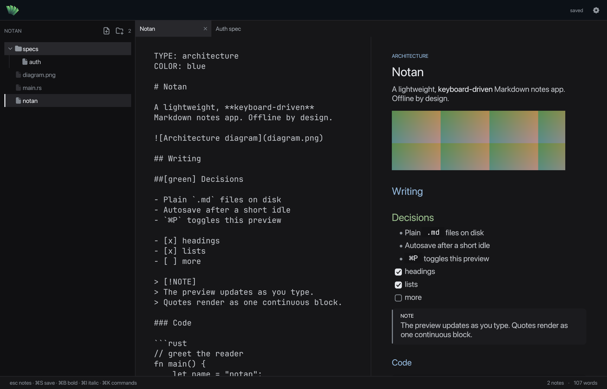

<p align="center">
  
</p>

<p align="center">
  <b>A calm, offline workspace for the Markdown specs your coding agents build from.</b><br />
  Open a project folder. Write the spec. Your agent reads the same files.
</p>

<p align="center">
  
  
  
  
  
  
</p>

---

## What is Notan?

Notan is a small macOS app for writing and organising the specification files that AI coding agents use.

Instead of pasting requirements into a chat window, you keep them as plain Markdown inside the project. Notan gives those files a proper home: a file tree that hides the code, a focused editor, a live preview, and no distractions.

Your agent reads the same folder directly. There is no export step, no database, and no AI inside the app.



---

## Why teams use it

- **One source of truth.** Specs live in the repository next to the code, in plain `.md` files.
- **Nothing to learn.** Standard Markdown, standard folders. Works with any agent that can read files.
- **Stays out of the way.** No accounts, no sync, no telemetry, no internet requirement.
- **Safe by default.** Autosave, atomic writes, conflict detection, soft delete, and trash restore.
- **Fast to navigate.** Keyboard-first. Command palette, search, tabs, and a folder tree.
- **Readable by humans too.** Coloured headings and type labels make long specs easy to scan.

---

## Features

**Workspace**

- Open any project folder, or run `notan .` from the terminal.
- Tree of folders and Markdown files; code files appear dimmed and are not editable.
- Create, rename, move, and delete files and folders without leaving the keyboard.
- Tabs for open notes, restored on the next launch along with window size and expanded folders.

**Writing**

- Markdown editor with autosave and live preview.
- Headings, lists, task lists with clickable checkboxes, tables, block quotes, callouts, and fenced code.
- Syntax highlighting for common languages, with a copy button on every code block.
- Local images render in the preview.
- Relative links between specs open the target note.
- Bold and italic shortcuts; four-space tabs; undo for typing.

**Spec structure**

- `TYPE:` and `COLOR:` headers give a document a label and a default heading colour.
- Ten heading colours: `gray`, `red`, `orange`, `yellow`, `green`, `teal`, `blue`, `purple`, `pink`, `white`.
- Per-heading overrides with `##[green] Decisions`.
- YAML-style front matter is supported too.

**Keeping up**

- External edits from your agent or `git pull` refresh automatically when the note is clean.
- Dirty notes are protected: Notan will not overwrite a file that changed on disk.
- Trash browser restores deleted files and folders.

---

## Requirements

| Item | Requirement |
| --- | --- |
| Computer | Apple Silicon Mac (M1 or later) |
| macOS | 11 Big Sur or later |
| For building | Xcode Command Line Tools, Rust 1.88+ |
| Internet | Not required to run |

---

## Installation

Notan is distributed from this repository. Build it once, then copy the app to Applications.

```bash
git clone https://github.com/Snehal-Pradhan/Notan.git
cd Notan
./scripts/bundle.sh
cp -R dist/Notan.app /Applications/
```

If the app was transferred instead of built locally, clear the quarantine flag once:

```bash
xattr -dr com.apple.quarantine /Applications/Notan.app
```

Install the `notan` terminal command:

```bash
./scripts/install-cli.sh
```

This writes `~/.local/bin/notan`. If the script says the folder is not on your `PATH`, add it:

```bash
echo 'export PATH="$HOME/.local/bin:$PATH"' >> ~/.zshrc
```

---

## First run

1. Launch Notan.
2. Press `⌘O` and choose your project folder, or run `notan .` inside it.
3. Press `n` to create a spec, or `⌘⇧N` for a folder.
4. Point your coding agent at the same folder.

The last folder is remembered. Nothing leaves the machine.

---

## Writing a spec

A minimal document:

```markdown
TYPE: architecture
COLOR: blue

# Checkout service

Short summary of what this document covers.

## Context

##[green] Decisions
- One decision per line
- Keep it close to the code

## Open questions
- [ ] Who owns retries?
- [x] Logging format agreed
```

- `TYPE:` becomes a badge in the preview and picks a default heading colour.
- `COLOR:` overrides that default for every `##`–`######` heading.
- Add `##[colour]` to override a single heading.
- The directives stay in the file, so agents can read them too.

Callouts work as continuous blocks:

```markdown
> [!NOTE]
> Quotes stay one block across lines.
```

---

## Keyboard shortcuts

**Workspace**

| Key | Action |
| --- | --- |
| `⌘O` | Open folder |
| `⌘⇧O` | Reveal workspace in Finder |
| `⌘N` | New note |
| `⌘⇧N` | New folder |
| `⌘K` | Command palette |
| `⌘W` | Close tab |
| `⌘1` … `⌘9` | Switch tab |
| `⌘R` | Reload from disk |
| `⌘/` | All shortcuts |

**File tree** — press `esc` from the editor to focus it

| Key | Action |
| --- | --- |
| `j` / `k` or `↑` / `↓` | Move |
| `↵` | Rename file or folder |
| `space` / `→` | Open note or expand folder |
| `←` | Collapse folder or jump to parent |
| `e` / `Tab` | Open in editor |
| `n` / `⇧N` | New note / folder here |
| `d` | Move to trash |
| `/` | Search |
| `?` | Shortcuts |

**Editor**

| Key | Action |
| --- | --- |
| `⌘S` | Save now |
| `⌘Z` | Undo typing |
| `⌘B` / `⌘I` | Bold / italic |
| `Tab` | Four spaces |
| `⌘P` | Toggle preview |
| `⌘⇧P` | Preview only |
| `⌘⌫` | Move note to trash |

**Housekeeping**

| Key | Action |
| --- | --- |
| `⌘⇧C` | Copy selected path |
| `⌘⇧R` | Reveal selected in Finder |
| `⌘⇧T` | Open trash browser |
| `⌘⇧Z` | Restore last trashed note |
| `⌘⇧⌫` | Empty trash |
| `⌥⌘⌫` | Clear all notes to trash |

---

## Project structure

```text
src/app.rs         window, tree, tabs, shortcuts, overlays
src/markdown.rs    Markdown preview and callouts
src/store.rs       workspace files, trash, sessions
src/highlight.rs   code syntax highlighting
src/theme.rs       colours, fonts, icons
assets/            bundled font, icons, app mark
public/            README images
scripts/           app bundle and CLI installers
```

Build, test, and package:

```bash
cargo test
./scripts/bundle.sh
```

---

## Updating

```bash
cd Notan
git pull
./scripts/bundle.sh
cp -R dist/Notan.app /Applications/
```

Your notes live in your project folders, not inside the app, so updates never touch them.

---

## Troubleshooting

**“Notan is damaged” or “unidentified developer”**
Clear the quarantine flag: `xattr -dr com.apple.quarantine /Applications/Notan.app`.

**`notan: command not found`**
Add `~/.local/bin` to `PATH`, or reinstall with `NOTAN_BIN=/usr/local/bin ./scripts/install-cli.sh`.

**Dock shows the old icon**
macOS caches icons. Run `killall Dock`.

**A note says “changed on disk”**
The file was edited outside Notan. Press `⌘R` to reload it, or `⌘S` to overwrite deliberately.

**Images are not showing**
Only `png`, `jpeg`, `webp`, and `gif` up to 12 MB are rendered. HTTP images are skipped offline.

---

## Credits

- [JetBrains Mono](https://www.jetbrains.com/lp/mono/) for the editor and code, under the SIL Open Font License.
- [Tabler Icons](https://tabler.io/icons) for the interface icons.
- Built with [Rust](https://www.rust-lang.org/) and [egui](https://www.egui.rs/).

Internal use only.
