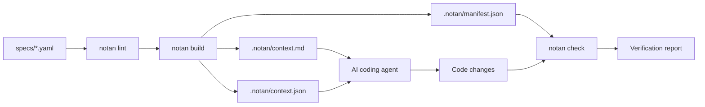

<p align="center">
  
</p>

<p align="center">
  <b>Spec-driven development for AI coding agents.</b><br />
  Write the specification once. Compile it into deterministic agent context. Ship code that matches the intent.
</p>

<p align="center">
  
  
  
  
  
  
</p>

---

## Table of Contents

- [Overview](#overview)
- [Why Notan](#why-notan)
- [How It Works](#how-it-works)
- [Requirements](#requirements)
- [Installation](#installation)
- [Quick Start](#quick-start)
- [Specification Format](#specification-format)
- [CLI Reference](#cli-reference)
- [Agent Integration](#agent-integration)
- [Configuration](#configuration)
- [Determinism Model](#determinism-model)
- [CI Enforcement](#ci-enforcement)
- [Performance](#performance)
- [Project Structure](#project-structure)
- [Development](#development)
- [Troubleshooting](#troubleshooting)
- [Security](#security)
- [License](#license)

---

## Overview

**Notan** is a Rust CLI that turns detailed specification sheets into a compiled, versioned context artifact for AI coding agents.

AI agents are non-deterministic because their input is non-deterministic. Requirements arrive as ad-hoc chat prompts, README fragments, ticket comments, and tribal knowledge. Notan replaces that surface with a single structured source of truth: a spec sheet written in your repository, validated by the compiler, and injected into the agent at a stable content hash.

| Problem | Notan response |
| --- | --- |
| Agent invents requirements | Requirements are explicit, enumerated, and stable in identity |
| Agent drifts across sessions | Context compiled to a content-addressed artifact |
| Agent rewrites unrelated code | Scope boundaries declared per requirement |
| Review cannot verify intent | Every acceptance criterion maps to checks and tests |
| Prompt engineering is undocumented | Spec is a reviewable file, diffable in pull requests |
| Output varies by editor or model | Single compiled artifact consumed by every agent |

Notan is not a prompt library and not a documentation generator. It is a **build step**: specs in, deterministic context out.

---

## Why Notan

- **Specs are code.** YAML documents parsed, type-checked, cross-referenced, and linted at build time. Broken specs fail the build, not the agent.
- **Determinism by construction.** Output ordering, identifier assignment, whitespace, and hashing are defined by the compiler — identical input bytes always produce identical output bytes.
- **Agent-agnostic.** One artifact, consumable by Claude Code, Cursor, Codex CLI, OpenCode, or a raw SDK call.
- **Scope-aware.** Each requirement declares the files and modules it may touch, which constrains agent edits and review surface.
- **Native on Apple Silicon.** Distributed as a universal binary with an ARM64 fast path; no runtime, no Node, no Python.
- **Fast.** Incremental compilation in single-digit milliseconds; full builds under a second on typical repositories.

---

## How It Works



1. **Author** a spec sheet in `specs/`. One file per feature, module, or API surface.
2. **Lint** with `notan lint`. Structural errors, unresolved references, missing acceptance criteria, and scope conflicts fail here.
3. **Build** with `notan build`. Specs are merged with repository metadata (file tree, symbol outline, dependency graph) and emitted as a single compiled context artifact with a stable digest.
4. **Consume** the artifact in any agent through the integration shim, or reference `.notan/context.md` directly.
5. **Verify** with `notan check`. Declared requirements and acceptance criteria are matched against implementation state, producing a machine-readable report suitable for CI.

---

## Requirements

| Item | Requirement |
| --- | --- |
| CPU | Apple Silicon (M1, M2, M3, M4 and later) |
| Architecture | `arm64` (an `x86_64` build runs under Rosetta 2 but is unsupported) |
| macOS | 14 Sonoma or later |
| Shell | `zsh` or `bash` |
| Git | 2.39 or later |
| Rust (source builds only) | 1.80 or later, stable toolchain |
| Disk | 25 MB binary, plus compiled artifact cache |

Intel Macs and Linux are not supported in this internal release.

---

## Installation

### Homebrew (recommended)

```bash
brew tap notan-dev/tap
brew install notan
```

### One-line installer

```bash
curl -fsSL https://internal.example.com/notan/install.sh | sh
```

Installs to `~/.local/bin`. Add to `PATH` if not already present:

```bash
echo 'export PATH="$HOME/.local/bin:$PATH"' >> ~/.zshrc
```

### From source

```bash
git clone git@github.com:internal/notan.git
cd notan
cargo install --path crates/notan-cli --locked
```

### Verify installation

```bash
notan --version
# notan 1.0.0 (arm64-apple-darwin)
```

---

## Quick Start

```bash
# 1. Initialise Notan in a repository
cd ~/code/my-service
notan init

# 2. Create a spec sheet from the template
notan spec new payments/refund-flow

# 3. Edit the generated file
$EDITOR specs/payments/refund-flow.yaml

# 4. Validate structure and references
notan lint

# 5. Compile the agent context artifact
notan build

# 6. Wire the artifact into your agent
notan agent install claude-code
```

`notan init` creates:

```text
notan.toml              # project configuration
specs/
  _schema.yaml          # shared types and enums
  example.yaml          # annotated starter spec
.notan/                 # generated artifacts (git-ignored)
AGENTS.md               # agent entry point (generated, committed)
```

`notan build` output:

```text
notan build v1.0.0
  specs        6 files
  requirements 41
  criteria     118
  scope files  214
  artifact     .notan/context.md (86.2 KB)
  digest       sha256:4f1a9c2e8b7d33a0...
  duration     74 ms
```

---

## Specification Format

Spec sheets are YAML documents validated against the internal schema. Fields are versioned; unknown keys are rejected unless `strict = false`.

```yaml
apiVersion: notan/v1
kind: feature
id: payments.refund-flow
title: Refund flow
status: approved
owner: payments-team
version: 3

summary: >
  Customers may request a full or partial refund within 30 days of capture.
  Refunds are asynchronous, idempotent, and emit domain events.

context:
  modules:
    - payments/refund
    - payments/ledger
  depends_on:
    - payments.capture-flow
    - platform.event-bus

scope:
  allow:
    - src/payments/refund/**
    - src/payments/ledger/refund_*.rs
  deny:
    - src/payments/capture/**
    - migrations/**

invariants:
  - id: INV-1
    statement: A refund never exceeds the captured amount minus prior refunds.
  - id: INV-2
    statement: Refund identifiers are unique per payment intent.

requirements:
  - id: REQ-1
    statement: The API accepts a refund request with intent id and optional amount.
    priority: must
    acceptance:
      - id: AC-1
        given: a captured payment intent
        when: a refund request omits amount
        then: the full remaining amount is refunded
        verify: test
      - id: AC-2
        given: a refunded payment intent
        when: the same idempotency key is resubmitted
        then: the original refund is returned with HTTP 200
        verify: test

  - id: REQ-2
    statement: Refund state transitions are recorded in the ledger.
    priority: must
    acceptance:
      - id: AC-3
        given: a refund in pending state
        when: the provider confirms settlement
        then: exactly one ledger entry of type refund.settled exists
        verify: integration

non_goals:
  - Partial refunds across multiple currencies.
  - Manual refund approval workflows.

notes: |
  Provider callbacks are unordered and may duplicate. Handlers must be idempotent.
```

### Field semantics

| Field | Type | Required | Purpose |
| --- | --- | --- | --- |
| `apiVersion` | string | yes | Schema version, `notan/v1` |
| `kind` | enum | yes | `feature`, `module`, `api`, `migration`, `policy` |
| `id` | string | yes | Stable identifier, unique across the repository |
| `status` | enum | yes | `draft`, `review`, `approved`, `deprecated` |
| `owner` | string | yes | Accountable team |
| `version` | integer | yes | Monotonic spec revision |
| `summary` | string | yes | Intent in prose, 1–3 sentences |
| `context` | object | yes | Modules and upstream specs the agent must know |
| `scope` | object | yes | Allowed and denied path globs |
| `invariants` | list | no | Conditions that must hold at all times |
| `requirements` | list | yes | Enumerated obligations, at least one |
| `requirements[].acceptance` | list | yes | Given/when/then criteria with verification mode |
| `non_goals` | list | no | Explicit exclusions, prevents scope creep |
| `notes` | string | no | Free-form implementation guidance |

### Identifier rules

- Spec `id`: dotted lowercase segments, `^[a-z][a-z0-9]*(\.[a-z0-9-]+)+$`
- Requirement `id`: `REQ-<n>` scoped to the spec, assigned by `notan spec new` and never reused
- Acceptance `id`: `AC-<n>` scoped to the requirement
- Renaming an `id` requires `version` increment; `notan lint` reports it as a breaking change

---

## CLI Reference

Global flags: `--config <path>`, `--root <path>`, `--format <human|json>`, `--no-color`, `-v/--verbose`, `-q/--quiet`.

### `notan init`

Scaffold `notan.toml`, `specs/`, and agent entry points.

| Flag | Description |
| --- | --- |
| `--name <name>` | Project name recorded in the manifest |
| `--agent <name>` | Preconfigure an integration (`claude-code`, `cursor`, `codex`, `opencode`, `none`) |
| `--force` | Overwrite existing scaffolding |

### `notan spec new <path>`

Create a spec sheet at `specs/<path>.yaml` with assigned identifiers and schema comments.

| Flag | Description |
| --- | --- |
| `--kind <kind>` | Spec kind, defaults to `feature` |
| `--from <file>` | Base the new spec on an existing one |
| `--template <path>` | Use a custom template |

### `notan spec list`

List specs with status, owner, requirement count, and digest.

### `notan lint [paths...]`

Validate schema, identifiers, references, scope overlap, and acceptance coverage. Exits non-zero on error. Warnings are reported for missing `non_goals`, vague statements under 12 words, and specs without `verify: test` criteria.

### `notan build`

Compile specs into `.notan/`.

| Flag | Description |
| --- | --- |
| `--out <dir>` | Artifact directory, default `.notan` |
| `--format <md\|json\|both>` | Artifact formats, default `both` |
| `--include-tree` | Embed repository file tree |
| `--include-symbols` | Embed symbol outline from supported languages |
| `--max-bytes <n>` | Fail if artifact exceeds size budget |
| `--check` | Verify artifacts are current without writing (`--locked` equivalent) |

### `notan check [paths...]`

Compare implementation state against declared requirements and acceptance criteria. Emits a report to stdout and `.notan/report.json`.

| Flag | Description |
| --- | --- |
| `--strict` | Treat unverifiable criteria as failures |
| `--baseline <file>` | Diff against a previous report |
| `--fail-on <level>` | `error`, `warn`, or `never` |

### `notan diff <spec-id>`

Show the semantic diff between the working spec and the last committed revision: added, changed, and removed requirements with their acceptance criteria.

### `notan agent install <target>`

Install or refresh the integration shim for `claude-code`, `cursor`, `codex`, `opencode`, or `generic`. Writes marker-delimited blocks so existing instructions are preserved.

### `notan agent status`

Report installed integrations, artifact digest, and freshness.

### Exit codes

| Code | Meaning |
| --- | --- |
| `0` | Success |
| `1` | Lint or check failure |
| `2` | Usage error |
| `3` | Configuration error |
| `4` | Artifact out of date (`--check`) |
| `5` | Internal error |

---

## Agent Integration

Notan produces one artifact and adapts its presentation per agent. The digest is identical across integrations; only the surrounding instructions differ.

| Agent | Installation target | Generated file |
| --- | --- | --- |
| Claude Code | `claude-code` | `CLAUDE.md` block + `.claude/commands/notan-*.md` |
| Cursor | `cursor` | `.cursor/rules/notan.mdc` |
| Codex CLI | `codex` | `AGENTS.md` block |
| OpenCode | `opencode` | `AGENTS.md` block + `.opencode/command/` |
| Generic | `generic` | `AGENTS.md` block referencing `.notan/context.md` |

Generated block structure:

```markdown
<!-- notan:begin digest=4f1a9c2e -->
Read `.notan/context.md` before making changes. It is the authoritative
specification for this repository and was compiled from 6 spec sheets.

Rules:
1. Do not modify files outside a requirement's declared scope.
2. Do not add behaviour absent from the compiled requirements.
3. If a requirement is ambiguous, stop and report the ambiguity; do not guess.
4. Run `notan check` after implementation and resolve every error.
<!-- notan:end -->
```

`notan agent install --refresh` rewrites blocks in place. Content outside markers is never modified.

---

## Configuration

`notan.toml` at the repository root:

```toml
[project]
name = "my-service"
specs = "specs"
artifact = ".notan"

[schema]
api_version = "notan/v1"
strict = true            # reject unknown fields
require_acceptance = true
require_owner = true
min_statement_words = 12

[build]
formats = ["md", "json"]
include_tree = true
include_symbols = true
languages = ["rust", "typescript"]
max_bytes = 262144
sort = "id"              # id | path | insertion
normalize_whitespace = true

[check]
fail_on = "error"
strict = false

[agents]
installed = ["claude-code", "opencode"]
refresh_on_build = true
```

Environment overrides use the `NOTAN_` prefix, for example `NOTAN_BUILD_MAX_BYTES=1048576`. Precedence: CLI flags, environment, `notan.toml`, defaults.

---

## Determinism Model

Guarantees enforced by the compiler and covered by golden tests:

- Output is a pure function of spec content, repository file tree, and configuration. Timestamps and hostnames are excluded.
- Requirement and acceptance identifiers are sorted lexicographically before emission, not by file order.
- All paths are repository-relative, POSIX-separated, and case-sensitive.
- Text normalisation applies NFC, collapses intra-line whitespace, strips trailing whitespace, and terminates files with a single newline.
- The digest is `sha256` over the compiled artifact body, recorded in `manifest.json` and in every agent block.
- Builds are byte-identical across machines for identical inputs; `notan build --check` returns exit code `4` on mismatch.

Determinism is a property of the context artifact, not of the model. Notan cannot make a model deterministic; it removes input variance so behaviour differences are attributable to the model, not the requirements.

---

## CI Enforcement

```yaml
name: spec
on: [pull_request]

jobs:
  notan:
    runs-on: macos-14
    steps:
      - uses: actions/checkout@v4
      - uses: notan-dev/setup-notan@v1
        with:
          version: 1.0.0
      - run: notan lint --format json
      - run: notan build --check
      - run: notan check --strict --fail-on error
```

Recommended branch protection:

- `notan lint` must pass.
- Artifacts committed or cache-clean per team policy; `notan build --check` prevents stale context.
- Spec changes require owner approval; `CODEOWNERS` maps `specs/**` to owning teams.

---

## Performance

Measured on a MacBook Pro M3 Pro, 36 GB, macOS 15, warm cache.

| Operation | Specs | Median | p95 |
| --- | --- | --- | --- |
| `lint` | 120 | 11 ms | 18 ms |
| `build` | 120 | 96 ms | 141 ms |
| `build` (incremental) | 120 | 4 ms | 7 ms |
| `check` | 120 | 62 ms | 89 ms |
| `build` (cold, symbols on) | 480 | 410 ms | 612 ms |

Memory ceiling: under 180 MB for 500 specs with symbol extraction enabled.

---

## Project Structure

```text
notan/
  crates/
    notan-cli/        # argument parsing, command dispatch, output formatting
    notan-spec/       # schema types, parser, validation, identifier assignment
    notan-compile/    # context assembly, ordering, normalisation, hashing
    notan-agent/      # integration shims and marker rewriting
    notan-check/      # requirement-to-implementation verification
    notan-core/       # shared errors, config, filesystem abstractions
  schemas/
    notan-v1.json     # published JSON Schema
  tests/
    golden/           # byte-exact artifact fixtures
    integration/      # CLI end-to-end tests
  docs/
    spec-format.md
    determinism.md
```

---

## Development

```bash
cargo build --release
cargo test --workspace
cargo clippy --workspace --all-targets -- -D warnings
cargo fmt --check

# Regenerate golden fixtures after intentional output changes
UPDATE_GOLDEN=1 cargo test -p notan-compile golden

# Benchmarks
cargo bench -p notan-compile
```

Toolchain is pinned in `rust-toolchain.toml`. Releases are cross-compiled for `aarch64-apple-darwin` and notarised; binaries are signed with the internal Developer ID.

Contribution workflow: branch from `main`, spec change and implementation change in the same pull request, `notan lint` clean, one approving review from the owning team, squash merge.

---

## Troubleshooting

| Symptom | Cause | Resolution |
| --- | --- | --- |
| `error: unsupported architecture x86_64` | Running under Rosetta | Install the `arm64` build; do not force `arch -x86_64` |
| `error: artifact out of date (exit 4)` | Specs changed after last build | Run `notan build` and commit the agent block |
| `warning: spec has no non_goals` | Missing scope exclusion | Add `non_goals` or raise `min_statement_words` tolerance in config |
| `error: duplicate spec id` | Copied spec without renaming | Assign a new `id`; increment `version` |
| Agent ignores the spec | Integration block removed or stale | `notan agent install <target> --refresh` |
| `error: scope overlap` | Two specs claim the same path | Narrow one spec's `scope.allow` or merge specs |
| Build slow on first run | Symbol extraction cold cache | Subsequent builds are incremental; check `~/.cache/notan` |

Diagnostics: `notan doctor` reports toolchain, permissions, cache state, and integration health. Attach `notan doctor --format json` output to internal issues.

---

## Security

- No network access during `lint`, `build`, or `check`. All operations are local.
- Specs and artifacts are plain text and remain inside the repository.
- `notan agent install` writes only inside the repository and inside marker-delimited blocks.
- Signed and notarised release binaries; checksums published per release.
- Report vulnerabilities through the internal security channel, not public issues.

---

## License

Internal proprietary software. Copyright © 2026 Notan Dev. All rights reserved. Distribution outside the organisation is prohibited. Third-party dependency licences are listed in `THIRD_PARTY.md`.

<br />

<p align="center">
  
</p>

<p align="center">
  <sub><b>Notan</b> v1.0.0 &nbsp;·&nbsp; © 2026 Notan Dev &nbsp;·&nbsp; Internal Proprietary License &nbsp;·&nbsp; macOS arm64</sub>
</p>
